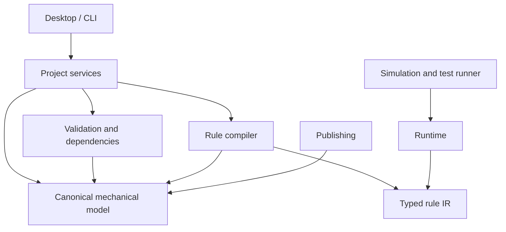

# Architecture baseline (proposed)

## 1. Ownership

Canonical project data owns authored types, values, entity definitions, relationships, rules and documentation references. Runtime state owns mutable instances. Evidence stores test inputs/results; presentation renders content. Persist these separately. SQLite may serve as derived index or storage implementation, but never establish a second independent writable authority. Decide canonical format before implementation.

## 2. Dependency direction

Core libraries must not depend on a desktop UI, VTT, network access or AI. Begin with one Rust library and an optional CLI; split only once integration requires enforced boundaries.

## 3. Kernel contracts to settle

Stable opaque IDs distinct from mutable names; typed schemas and values; explicit reference and relationship endpoint constraints; separate definitions/instances; unambiguous missing vs null; typed expressions with reference collection; stable deterministic serialization and schema versioning. Reject unknown or incompatible versions unless an explicit migration exists. Decide numeric types, units, overflow, precision, defaults and identity scope with fixtures.

## 4. Execution semantics

A runtime step accepts a versioned ruleset, action, context, state, random stream and recorded human choices. It evaluates guards, builds a candidate effect transaction, validates constraints, and commits all effects and events together or rejects without partial mutation. A missing human decision suspends at an explicit checkpoint; stale continuations are detected. Explicit effect ordering is required; do not silently rely on hash iteration or wall clock time. Diagnostics record rule and entity IDs, reasons and evaluation trace.

Random input and human decision capture enable deterministic replay. A seed alone is insufficient if generator algorithms, ordering or external inputs change; record versions and relevant inputs. Runtime does not interpret free-text prose as executable.

## 5. Analysis

Extract static reference edges from typed definitions/expressions. Classify hard derived-value cycles separately from event-triggered feedback and descriptive relationships. Report missing references, duplicate IDs, invalid values and type mismatch with source locations. More advanced reachability and balance checks must declare bounds, assumptions and uncertainty.

## 6. Authoring and publication

Forms, graphs and script views eventually edit one typed representation. Rulebook references resolve from canonical values; narrative prose is independently authored and reviewed. Generated outputs are disposable. AI proposals are validated and accepted explicitly, never silently committed.

## 7. MVP vertical slice

Create two original fixture projects (class-based and diceless), load and validate them, inspect references, save/reload without semantic loss and emit stable diagnostics through a CLI. Test no required combat, dice, attributes or character classes. Then add guarded deterministic state transitions and a separate runtime snapshot. See the [roadmap](../ROADMAP.md) for gates.
